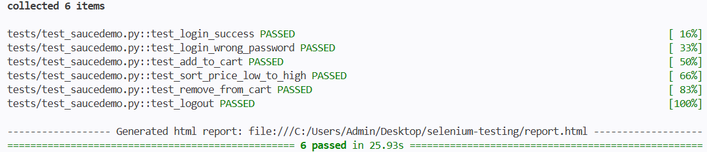
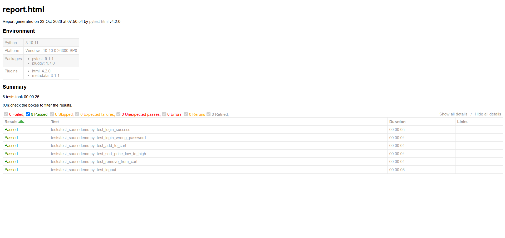

# Báo cáo kiểm thử tự động website với Selenium

## 1. Thông tin chung

| Mục | Nội dung |
|-----|----------|
| Sinh viên / nhóm | <họ tên, MSSV> |
| Môn học | <tên môn> |
| Giảng viên | <tên giảng viên> |
| Website kiểm thử | https://www.saucedemo.com |
| Công cụ chính | Selenium WebDriver (Python) |
| Số test case | 6 (yêu cầu tối thiểu 5) |
| Kết quả | 6 passed, 0 failed |

## 2. Mục tiêu

- Tìm hiểu công cụ kiểm thử tự động Selenium.
- Xây dựng tối thiểu 5 test case tự động cho một website: đăng nhập, giỏ hàng, sắp xếp, đăng xuất.
- Sinh báo cáo kết quả chạy test và nộp qua GitHub.

## 3. Giới thiệu Selenium

Selenium là bộ công cụ mã nguồn mở dùng để tự động hóa thao tác trên trình duyệt (mở trang, nhập liệu, bấm nút, đọc nội dung) nhằm kiểm thử chức năng ứng dụng web. Selenium gồm 3 thành phần:

- **Selenium WebDriver**: thư viện cho phép viết code điều khiển trình duyệt. Dự án này sử dụng thành phần này.
- **Selenium IDE**: tiện ích ghi và phát lại thao tác, không cần code.
- **Selenium Grid**: chạy test song song trên nhiều máy và trình duyệt.

Cách hoạt động: code Python gửi lệnh qua Selenium WebDriver, ChromeDriver chuyển lệnh cho Chrome thực hiện và trả kết quả về. Từ Selenium 4, ChromeDriver được tải tự động.

## 4. Website kiểm thử

[Sauce Demo](https://www.saucedemo.com) là website thương mại điện tử mẫu dùng để luyện kiểm thử, có đủ các chức năng đăng nhập, danh sách sản phẩm, giỏ hàng, sắp xếp và đăng xuất.

Tài khoản sử dụng:

| Username | Password |
|----------|----------|
| standard_user | secret_sauce |

## 5. Môi trường và công cụ

| Thành phần | Phiên bản |
|-----------|-----------|
| Hệ điều hành | Windows 10 |
| Python | 3.10.11 |
| Selenium | 4.x |
| pytest | 9.1.1 |
| pytest-html | 4.2.0 |
| Trình duyệt | Google Chrome 155 |
| Editor | Visual Studio Code |

## 6. Cấu trúc thư mục

```
selenium-testing/
├── tests/
│   └── test_saucedemo.py     # 6 test case tự động
├── screenshots/
│   ├── terminal.png          # ảnh kết quả chạy trên terminal
│   └── report.png            # ảnh báo cáo HTML
├── report.html               # báo cáo HTML do pytest-html sinh ra
├── requirements.txt          # danh sách thư viện
├── .gitignore
└── README.md
```

## 7. Hướng dẫn cài đặt và chạy

**Bước 1.** Cài Python 3.10 trở lên và Google Chrome.

**Bước 2.** Clone repo:

```
git clone https://github.com/Chilliess/selenium-testing.git
cd selenium-testing
```

**Bước 3.** Tạo và kích hoạt môi trường ảo:

```
python -m venv venv
venv\Scripts\activate
```

**Bước 4.** Cài thư viện:

```
python -m pip install -r requirements.txt
```

**Bước 5.** Chạy test và xuất báo cáo HTML:

```
python -m pytest -v --html=report.html --self-contained-html
```

Chrome sẽ tự mở và đóng cho từng test case. Kết quả hiển thị trên terminal và được lưu vào `report.html`.

## 8. Thiết kế mã kiểm thử

Toàn bộ code nằm trong `tests/test_saucedemo.py`, gồm:

| Thành phần | Vai trò |
|-----------|---------|
| `driver` (pytest fixture) | Mở Chrome, tắt popup đổi mật khẩu, vào trang chủ trước mỗi test và đóng trình duyệt sau mỗi test, giúp các test độc lập nhau |
| `wait_for()` | Chờ phần tử hiển thị (tối đa 10 giây) bằng `WebDriverWait` |
| `click()` | Chờ phần tử có thể bấm được rồi mới bấm |
| `login()` | Dùng chung cho các test, nhập tài khoản, bấm Login và chờ vào trang sản phẩm |

Các kỹ thuật chính được sử dụng:

- **Định vị phần tử** bằng `By.ID`, `By.CLASS_NAME`, `By.CSS_SELECTOR`.
- **Thao tác**: `click()`, `send_keys()`, `Select(...).select_by_value()`.
- **Chờ tường minh** (`WebDriverWait` + `expected_conditions`) thay cho `time.sleep()`.
- **Kiểm tra kết quả** bằng `assert` (URL, nội dung văn bản, số lượng phần tử).

## 9. Danh sách test case

| ID | Tên test case | Dữ liệu | Các bước thực hiện | Kết quả mong đợi | Kết quả thực tế |
|----|---------------|---------|--------------------|------------------|-----------------|
| TC01 | Đăng nhập thành công | standard_user / secret_sauce | 1. Mở trang chủ<br>2. Nhập username, password<br>3. Bấm Login | URL chứa `/inventory.html`, tiêu đề trang là "Products" | Pass |
| TC02 | Đăng nhập sai mật khẩu | standard_user / sai_mat_khau | 1. Mở trang chủ<br>2. Nhập username và mật khẩu sai<br>3. Bấm Login | Hiện thông báo "Username and password do not match" | Pass |
| TC03 | Thêm sản phẩm vào giỏ hàng | Sauce Labs Backpack | 1. Đăng nhập<br>2. Bấm Add to cart ở Backpack<br>3. Mở giỏ hàng | Biểu tượng giỏ hiện số 1, giỏ hàng có "Sauce Labs Backpack" | Pass |
| TC04 | Sắp xếp sản phẩm theo giá tăng dần | Price (low to high) | 1. Đăng nhập<br>2. Chọn sắp xếp "Price (low to high)" | Danh sách giá được sắp xếp tăng dần | Pass |
| TC05 | Xóa sản phẩm khỏi giỏ hàng | Sauce Labs Bike Light | 1. Đăng nhập<br>2. Thêm Bike Light<br>3. Mở giỏ hàng<br>4. Bấm Remove | Giỏ hàng không còn sản phẩm nào | Pass |
| TC06 | Đăng xuất | standard_user / secret_sauce | 1. Đăng nhập<br>2. Mở menu<br>3. Bấm Logout | Quay về trang đăng nhập, nút Login hiển thị | Pass |

## 10. Kết quả chạy

Tổng kết: **6 test case, 6 passed, 0 failed, thời gian chạy khoảng 26 giây.**

**Kết quả trên terminal:**



**Báo cáo HTML (`report.html`):**



## 11. Khó khăn gặp phải và cách khắc phục

| Vấn đề | Nguyên nhân | Cách khắc phục |
|--------|-------------|----------------|
| `python -m pip` báo "No module named pip" | Lệnh `python` trỏ vào Python của MSYS2 thay vì Python cài từ python.org | Dùng `py -3.10 -m venv venv` để tạo môi trường ảo bằng đúng bản Python, sau đó chỉ dùng `python` trong venv |
| pytest báo `collected 0 items` | Chưa tạo thư mục `tests` và file `test_` đúng tên | Tạo `tests/test_saucedemo.py` (tên file và tên hàm phải bắt đầu bằng `test_`) |
| `StaleElementReferenceException` ở TC05 | Tìm nút Remove khi trang giỏ hàng còn đang tải và vẽ lại | Chờ URL `/cart.html` và phần tử xuất hiện trước khi bấm |
| `NoSuchElementException` ở TC03 | Tìm nút Add to cart khi trang sản phẩm chưa tải xong sau khi đăng nhập | Cho hàm `login()` chờ trang sản phẩm tải xong, dùng `WebDriverWait` cho mọi thao tác bấm |
| Popup "Change your password" của Chrome | Chrome tự hiện popup khi phát hiện đăng nhập | Tắt trình quản lý mật khẩu bằng `ChromeOptions` trong fixture |

## 12. Bài học rút ra

- Không nên thao tác ngay khi trang chưa tải xong; dùng chờ tường minh (`WebDriverWait`) giúp test ổn định, nhanh hơn `time.sleep()`.
- Mỗi test cần độc lập (mỗi test mở một trình duyệt mới) để lỗi của test này không ảnh hưởng test khác.
- Nên tách các bước lặp lại (đăng nhập, chờ, bấm) thành hàm dùng chung để code ngắn gọn, dễ bảo trì.
- Dùng môi trường ảo (`venv`) để tránh xung đột phiên bản Python và thư viện.

## 13. Hạn chế và hướng phát triển

- Mới kiểm thử luồng chính trên trình duyệt Chrome, chưa chạy trên Firefox hoặc Edge.
- Chưa kiểm thử các tài khoản đặc biệt của website (như `locked_out_user`) và chức năng thanh toán (checkout).
- Có thể mở rộng bằng mô hình Page Object, chụp ảnh màn hình khi test thất bại và chạy test song song.

## 14. Tài liệu tham khảo

- <tên video / link hướng dẫn Selenium đã xem>
- Tài liệu chính thức Selenium: https://www.selenium.dev/documentation/
- Tài liệu pytest: https://docs.pytest.org/
- Website kiểm thử: https://www.saucedemo.com